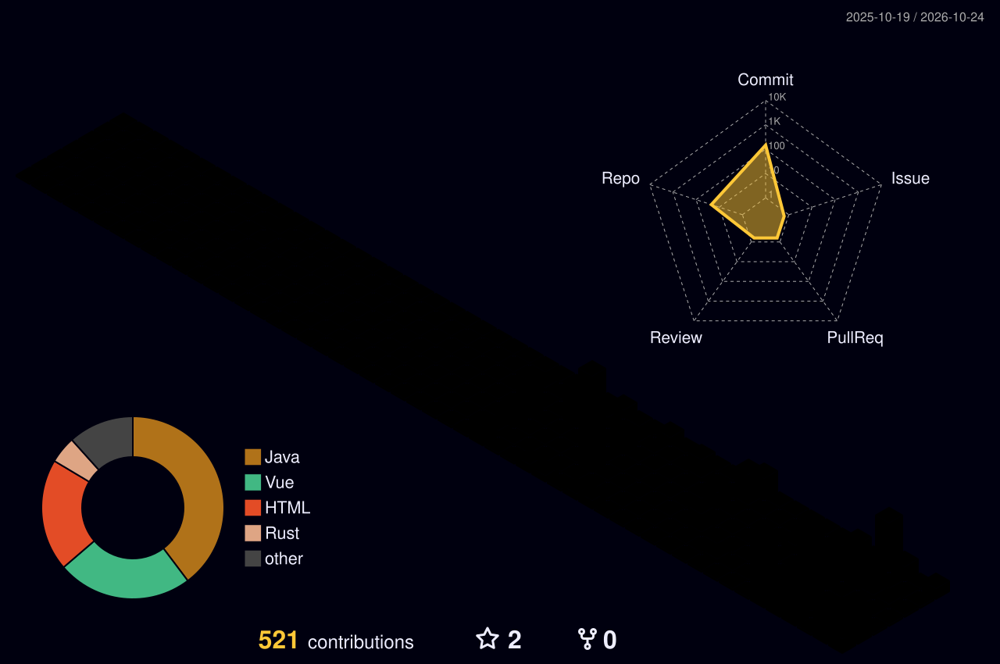

# 👋 Mohamad Habachia
**Network Engineer • Tech Enthusiast • Business Informatics @ HTW Berlin**

*Bridging the gap between deep infrastructure engineering and modern cloud automation.*

 

### 👨‍💻 About Me & Expertise

I am a **Certified IT Specialist for System Integration (IHK)**, currently expanding my academic foundation by studying **Business Informatics at HTW Berlin**. With a strong engineering background, I specialize in building, securing, and automating robust enterprise environments. 

- 🌐 **Enterprise Networking:** Architecture design, 802.1X, VLAN segmentation, routing, and switching.
- 🔒 **Security & Zero Trust:** Designing Site-to-Site and Client-to-Site VPNs (IPsec, WireGuard, OpenVPN).
- ⚙️ **Systems & Virtualization:** High-Availability setups, multi-OS environments, and enterprise storage (ZFS/iSCSI).
- 🚀 **Current Trajectory:** Evolving into DevOps & Cloud Automation, focusing on CI/CD pipelines, Infrastructure as Code (IaC), and distributed self-hosted systems.

 

### 💻 Tech Stack & Tools

  
  
  
  
  
  
  
  
  
  
  
  
  
  
  
  
  
  
  
  
  
  
  
  
  
  
  
  
  
  
  
  
  
  
  
  
  
  
  
  

 

### 📊 Activity & Contributions

  

 

  
  

 

  

