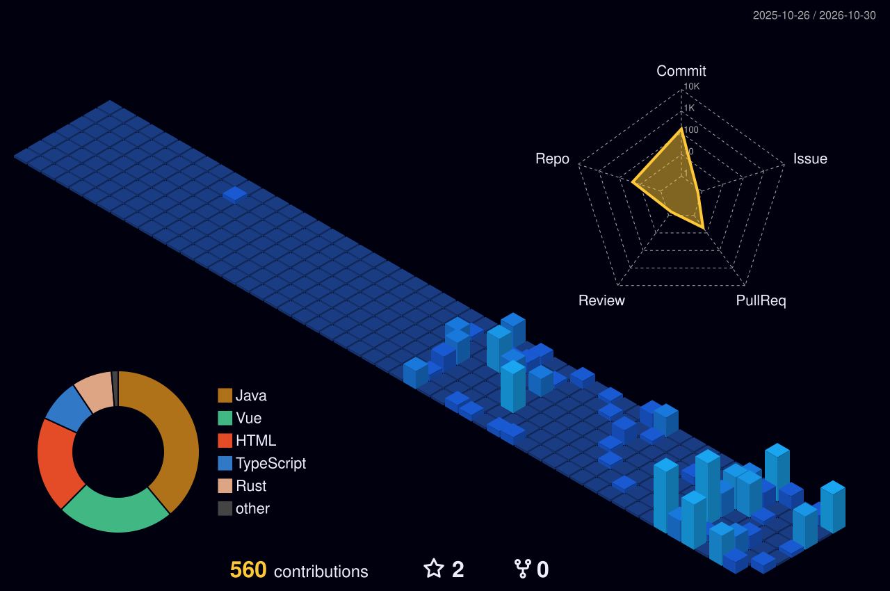

# 💫 About Me:

Network engineer and tech geek. 
Studying business informatics at HTW Berlin. 
Coding my way in as a DevOps. 
Experienced in designing, implementing, and maintaining medium to large enterprise networks. 

## 🌐 Socials:

# 💻 Tech Stack:
                         

# 📊 GitHub Stats:
 
 

### ✍️ Random Dev Quote

